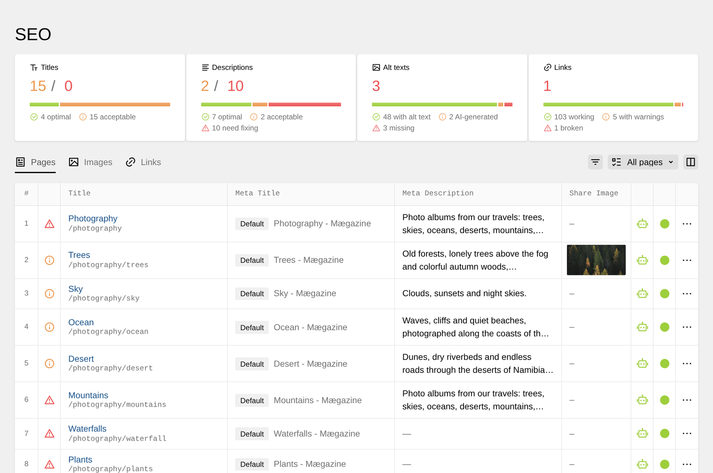
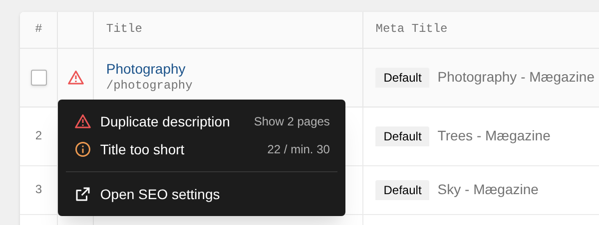
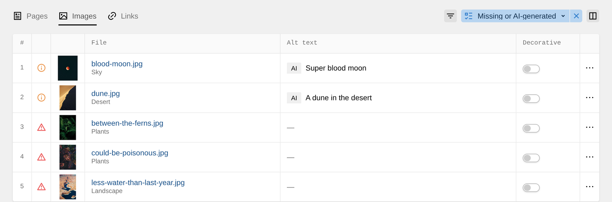
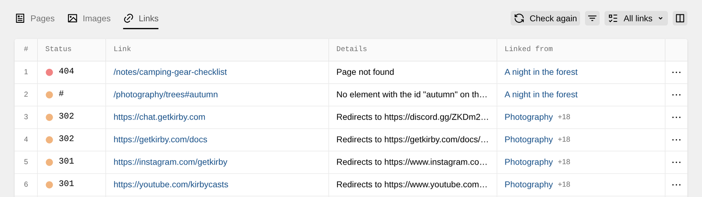

Checking metadata one page at a time gets difficult as your site grows. Duplicate titles make search results harder to tell apart, missing descriptions leave search engines to choose their own snippet, and broken links send visitors to pages that do not exist.

Kirby SEO adds an **SEO** item to the Panel menu. It checks all eligible pages and images at once. Four cards summarize **Titles**, **Descriptions**, **Alt texts**, and **Links**. Click a card with issues to open the relevant tab and show only the items that need attention.



If you set a [custom Panel menu](https://getkirby.com/docs/reference/system/options/panel/panel-menu) with the `panel.menu` option, Kirby only shows the areas in your list. Add `seo` to the list to show the SEO item:

```php
// site/config/config.php
return [
  'panel' => [
    'menu' => [
      'site',
      'seo',
      'users',
      'system',
    ],
  ],
];
```

## Which pages are checked

Add the SEO tab to each page blueprint that you want to include:

```yaml
# site/blueprints/pages/default.yml
tabs:
  content:
    fields:
      # your existing fields
  seo: seo
```

The overview lists published pages that search engines may index and that you can access in the Panel. Drafts, pages with a page-specific `noindex`, and unlisted pages with the default robots settings are left out. See [Robots & Indexing](1_features/00_robots-indexing) for the rules behind this.

On multilingual sites, use the language button in the header to switch the overview language.

<details>
<summary>Indexing and translation details</summary>

Pages without a translation are still listed with content from the default language. Their metadata is not checked until the translation exists. A global `robots.index` setting, including the default setting in debug mode, does not remove otherwise eligible pages from the overview.

</details>

## Page checks

A clear, unique title helps visitors choose the right search result. A useful description gives them a preview of the page before they click. Search engines use both values as candidates and may choose different text.

The overview separates issues that **need fixing** from length notices that are still **acceptable**.

These issues need fixing:

- **Duplicate title** means that several pages have the same title in search results.
- **No description** means that the page has no meta description.
- **Fallback description** means that the page uses inherited or default text instead of its own description. The home page can use a fallback without an issue.
- **Duplicate description** means that several pages use the same page-specific description.

These length notices are acceptable:

- **Title too short** and **Title too long** compare the complete search result title with the recommended range.
- **Description too short** and **Description too long** compare the description with its recommended range.

The default range is 30 to 60 characters for titles and 70 to 160 characters for descriptions. Long text may be cut off in search results. Very short text may not give visitors enough context. Change the ranges in your config when your site needs different guidance:

```php
// site/config/config.php
return [
  'tobimori.seo' => [
    'overview' => [
      'lengths' => [
        'title' => [30, 60],
        'description' => [70, 160],
      ],
    ],
  ],
];
```

Click the icon next to a page's title to see all of its issues. Clicking an issue filters the table to every page with the same issue, and for a duplicate it shows the pages that share the value. Choose **Open SEO settings** to edit the page in its Metadata & SEO tab.



### Editing in the table

Click a **Meta Title** or **Meta Description** cell to edit it. Open **Columns** to add **Share Description** when that field is available in the page blueprint. Kirby stores table edits as unsaved changes. Use **Save** or **Discard** in the header when you are ready. If you select changed rows first, the action applies only to those rows. With no selection, it applies to every changed row.

When [AI Assist](1_features/04_ai-assist) is configured and your role has the `tobimori.seo.ai` permission, select pages and click **Generate**. You can generate a **Meta Title**, **Meta Description**, or **Share Description**. **Only pages without their own value** is enabled by default. Generated text stays in unsaved changes for you to review before publishing.

## Image alt texts

Alt text helps people who use screen readers understand meaningful images. It also gives search engines information about image content. Decorative images need an empty alt attribute, which tells screen readers to skip them.

Add an `alt-text` field to your file blueprint to include its images in the overview:

```yaml
# site/blueprints/files/image.yml
fields:
  alt:
    type: alt-text
    label: Alt Text
```

See [Alt Text Field](1_features/05_alt-texts) for template usage and automatic generation on upload.

The **Images** tab shows four states:

- **Alt text missing**
- **Generated by AI, not reviewed yet**
- **Decorative, no alt text needed**
- **Has alt text**



Click an **Alt text** cell to write or edit a description. Use the **Decorative** toggle for a purely visual image. Select several rows and use **Mark as** to mark them as **Reviewed**, **Decorative**, or **Needs description**.

With AI Assist and the `tobimori.seo.ai` permission, select images and click **Generate**. **Only images without alt text** is enabled by default. Generated descriptions remain unsaved and marked as AI-generated until someone reviews them.

## Broken links

Broken links stop visitors and crawlers from reaching the expected page or file. The **Links** tab checks links from published, indexable pages. It checks internal pages and files, anchors such as `#contact`, external URLs, and redirects.

The first check starts when you open the tab. It can take a few minutes. You can leave the page and continue the check later. Results are marked as **Broken**, **Anchor not found**, **Redirects**, **Not checked**, or **Works**. Click **Check again** to run a full new check, or use a row's menu to check one link again.



If your site is also reachable under another host, such as `www.example.com`, add it to `links.hosts`. Links to that host are then checked like links to your own pages:

```php
// site/config/config.php
return [
  'tobimori.seo' => [
    'links' => [
      'hosts' => ['www.example.com'],
    ],
  ],
];
```

### Checking links in the background

Install `tobimori/kirby-queues` to run link checks in a queue worker. Kirby SEO schedules a full check every day at 3 am UTC by default. You can change the cron expression in your config:

```php
// site/config/config.php
return [
  'tobimori.seo' => [
    'links' => [
      'queue' => true,
      'schedule' => '0 3 * * *',
    ],
  ],
];
```

Set `schedule` to `false` to turn off scheduled checks. See [Background Processing](2_customization/09_background-processing) for queue setup.

## Restricting access

The SEO overview is available to every role by default. Set the `tobimori.seo.overview` permission to `false` in a role blueprint to hide it from that role:

```yaml
# site/blueprints/users/editor.yml

title: Editor
permissions:
  tobimori.seo:
    overview: false
```

See [Permissions](3_reference/1_permissions) for all plugin permissions.
