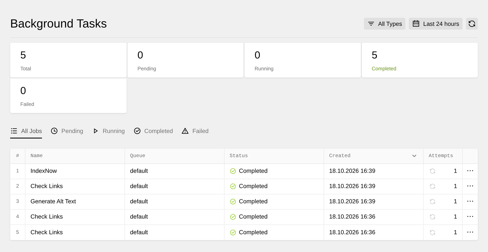

Some SEO work takes long enough to interrupt an editor. Checking links requires rendering pages, generating alt text waits for an AI provider, and IndexNow sends requests to search engines.

Kirby SEO uses [Kirby Queues](https://www.andkindness.com/queues/docs) when it is installed. Editors can continue working while a separate command-line worker handles these jobs.

## What runs in the background

Kirby SEO adds three types of jobs to the queue:

- **Check Links** (`seo:check-links`) checks the links shown in the [SEO Overview](1_features/07_seo-overview). Content changes within 60 seconds are grouped into one check. Clicking **Check again** in the Panel queues a full check immediately. A full check is also scheduled every day at 3 am UTC by default.
- **Generate Alt Text** (`seo:generate-alt-text`) runs after an image upload when [AI Assist](1_features/04_ai-assist) is configured. It fills [Alt Text Field](1_features/05_alt-texts) fields that have `autogenerate: true`.
- **IndexNow** (`seo:indexnow`) collects page changes for 30 seconds, removes duplicates, and sends them to [IndexNow](1_features/02_indexnow) in one request.

## Without Kirby Queues

All three features also work without the queue package.

The link check runs one step at a time while someone has the **Links** tab open. It pauses when they leave the tab and continues when someone opens it again. Scheduled link checks are not available in this mode.

Alt text generation runs as part of the image upload. The upload waits until the AI provider responds. IndexNow sends one request immediately for each page change.

## Setting up Kirby Queues

Follow the [Kirby Queues docs](https://www.andkindness.com/queues/docs/installation) to install the plugin, and the [Workers guide](https://www.andkindness.com/queues/docs/workers) to keep a worker running on your server. Kirby SEO registers its jobs automatically once the plugin is installed.

Make sure the worker loads the same site URL as your web server. Set an absolute `url` in your config, or set `KIRBY_HOST` for the worker as described in the Workers guide. Kirby uses the site URL to name its cache folders, and Kirby Queues stores its jobs in the cache. With a different URL, the worker can't find the jobs created in the Panel.

```php
// site/config/config.php
return [
  'url' => 'https://example.com',
];
```

With an absolute URL, the worker fetches your pages over HTTP for the link check. Your server must be able to reach its own site URL. Set `links.http` to `false` to render the pages inside the worker instead:

```php
// site/config/config.php
return [
  'tobimori.seo' => [
    'links' => [
      'http' => false,
    ],
  ],
];
```

The worker registers the scheduled link check when it starts. Scheduled times use UTC unless you set a different time zone. [Scheduling](https://www.andkindness.com/queues/docs/scheduling) in the Kirby Queues docs shows how.

## Monitor jobs in the Panel

Kirby Queues adds a **Background Tasks** area to the Panel menu. Its cards show the total, pending, running, completed, and failed jobs. Use the tabs and job table to inspect each status.



## Configure link checks

The daily link check uses the cron expression `0 3 * * *`. Change the schedule or set it to `false` to turn scheduled checks off:

```php
// site/config/config.php
return [
  'tobimori.seo' => [
    'links' => [
      'schedule' => '0 3 * * *',
    ],
  ],
];
```

Set `links.queue` to `false` if you want link checks to continue in the Panel after installing Kirby Queues:

```php
// site/config/config.php
return [
  'tobimori.seo' => [
    'links' => [
      'queue' => false,
    ],
  ],
];
```

See the [options reference](3_reference/0_options) for all background-processing settings.
